# 代码流程图：整个程序是怎么跑起来的

这份文件只回答一件事：**代码从哪进、经过谁、在哪里改文件、出错往哪退**。
它和 [`架构与流程.md`](架构与流程.md) 的分工：

| 文件 | 回答什么 |
|---|---|
| 本文 | 程序结构、函数调用链、分支与回退（给"想改代码/想确认它到底做了什么"的人看） |
| `架构与流程.md` | 四层职责、一次需求经过哪几步、出错先看哪层（给"想用/想排错"的人看） |

> 行号以当前提交（`d362ecf`）为准；改代码后可能偏移，函数名不会变。
> 图用 Mermaid 画，VS Code / Typora / PyCharm（装 Mermaid 插件）/ Gitee 都能直接渲染；
> 看不了图就看每一节开头的"文字版"。想先要"人话版"的比喻和图片，看 [小白也能看懂的程序流程.md](小白也能看懂的程序流程.md)。

---

## 1. 先看这张总图（文字版，任何编辑器都能读）

```
                    ┌──────────────────────────────┐
   中文一句话 ─────► │ nl.py    规则解析（离线兜底） │──┐
                    └──────────────────────────────┘  │
                    ┌──────────────────────────────┐  │   recipe（dict）
   本地 Ollama ───► │ llm.py   模型输出 JSON       │──┴──────────┐
                    └──────────────────────────────┘             │
                                                                 ▼
                                                    ┌────────────────────────┐
                                                    │ recipe.py  schema 校验 │
                                                    │ 未知 op/键 → 直接报错  │
                                                    └───────────┬────────────┘
                                                                ▼
                                    ┌───────────────────────────────────────┐
                                    │ poscar.py  结构操作（纯函数，不改入参）│
                                    │ incar.py   INCAR 白名单 + 预设 + 底稿  │
                                    │ kpoints.py 四种 KPOINTS 模式           │
                                    └───────────────┬───────────────────────┘
                                                    ▼
                                    ┌───────────────────────────────────────┐
                                    │ report.py  diff / change_report / 审计 │
                                    └───────────────┬───────────────────────┘
                                                    ▼
                          service.py：先写临时舞台  .tmp_service/<job_id>/out
                                                    │
                                     网页显示摘要 + diff（还没碰最终目录）
                                                    │  你点「写入」
                                                    ▼
                                    runs/<你起的名字>/  ← 只有这一步写最终目录
```

一句话记住：**理解 → 校验 → 结构/参数计算 → 报告 → 舞台预览 → 确认后落盘**。
前五步都可重复、都不改源目录；只有最后一步写新目录。

---

## 2. 模块依赖（谁 import 谁）

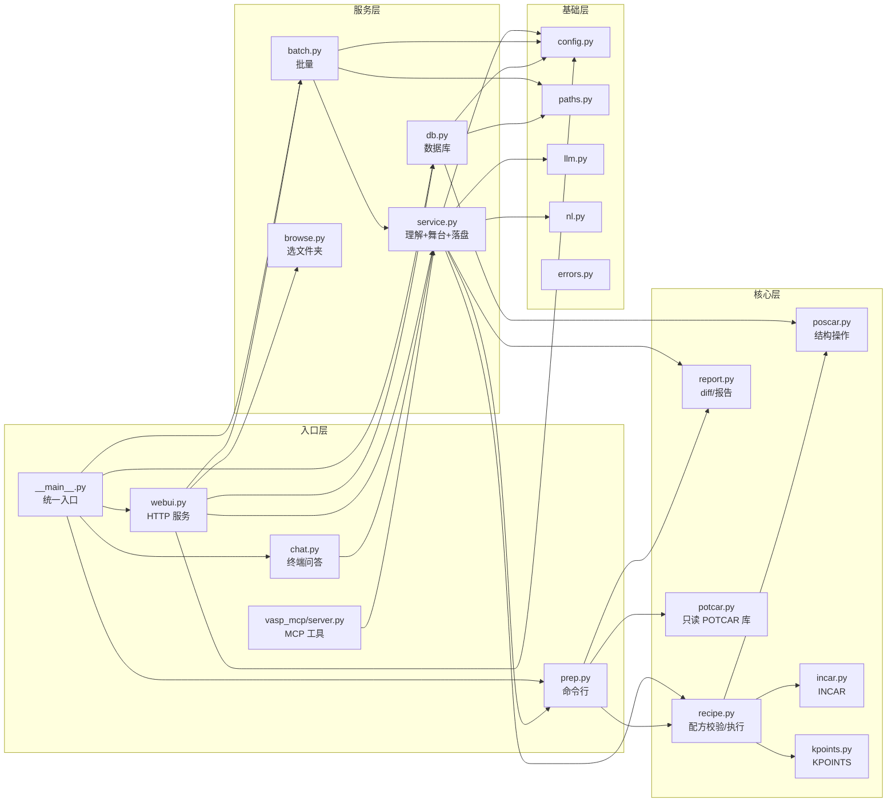

依赖方向是单向的：**入口 → 服务 → 核心 → 基础**。
核心层（`poscar/incar/kpoints/report`）不 import 服务层，也不读 HTTP、不打印，
所以 167 项测试里的绝大多数不用起服务。

---

## 3. 程序怎么启动

### 3.1 双击「启动网页.bat」

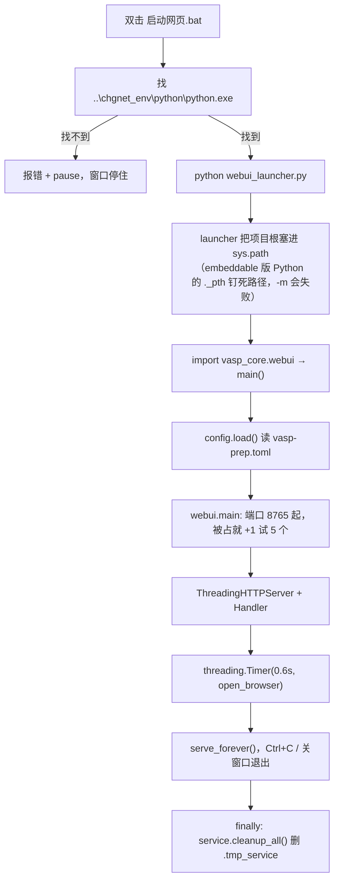

对应代码：`webui_launcher.py` → `vasp_core/webui.py:438`（`main`）。

### 3.2 终端 / 命令行

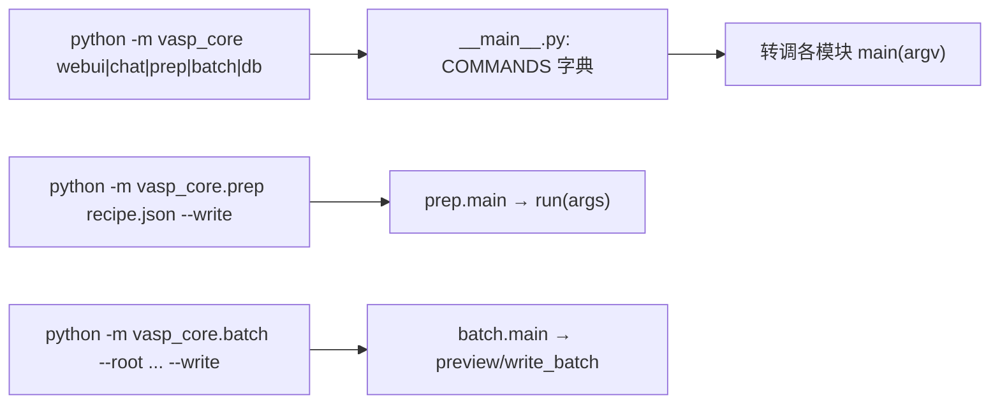

`__main__.py` 只做转发，不含业务逻辑；无参数打印用法返回 2，`-h` 返回 0，未知子命令返回 2。

---

## 4. 一次「预览」的完整调用链

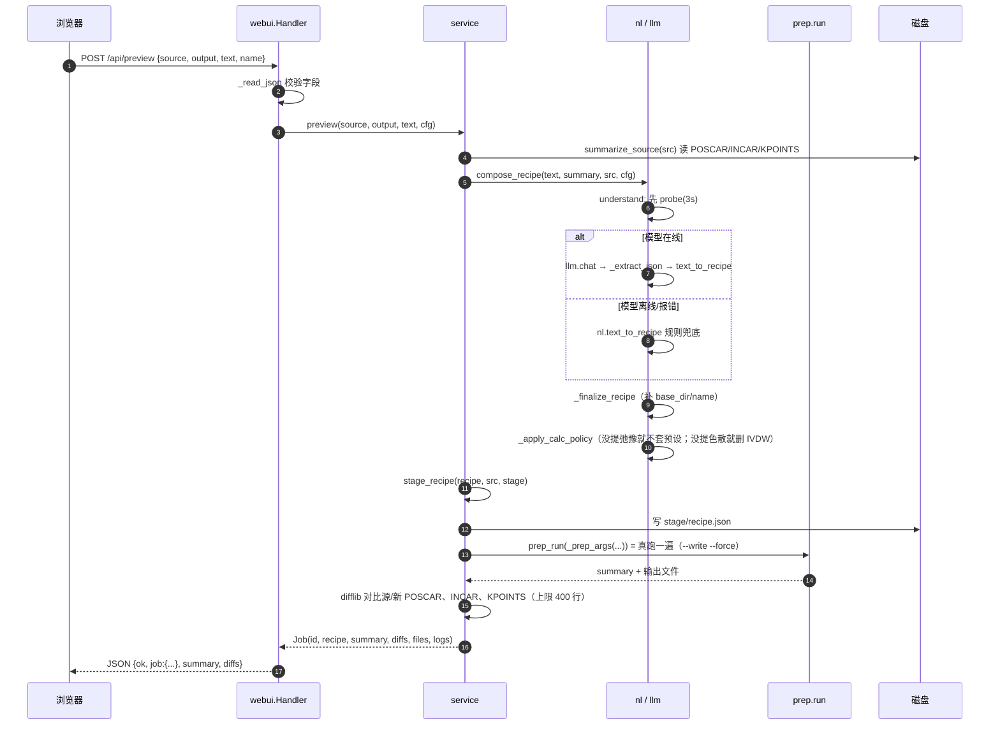

关键点（都在 `service.py`）：

- `preview()`（`service.py:383`）**只写舞台** `.tmp_service/<job_id>/out`，失败就 `shutil.rmtree(stage)`，不会留下半成品；
- `compose_recipe()`（`service.py:308`）= `understand` + 补全 + 两条策略（calc / IVDW）；
- `stage_recipe()`（`service.py:341`）真的调用 `prep.run`，所以预览看到的就是"写盘会得到的东西"，不是估算；
- 内存里只留最近 10 个 `Job`（`_cleanup_old_jobs`），旧的连舞台一起删。

### 4.1 `summarize_source` 读什么

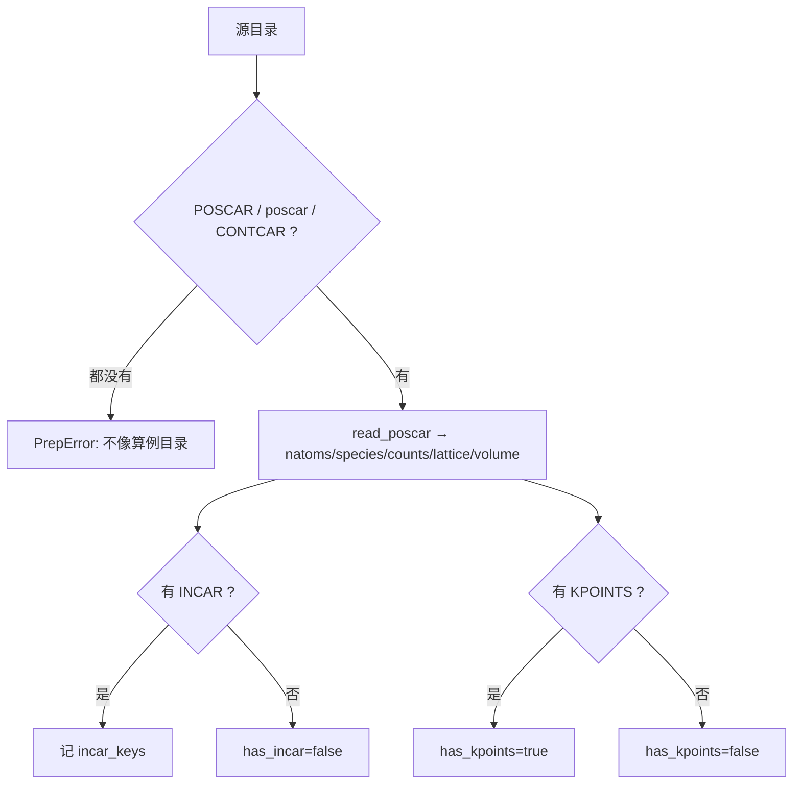

返回值只含"几原子、什么元素、晶格、有没有 INCAR/KPOINTS"，**不含坐标**——
这也是 strict 隐私模式下能安全发给本地模型的摘要。

---

## 5. 一次「写入」的调用链

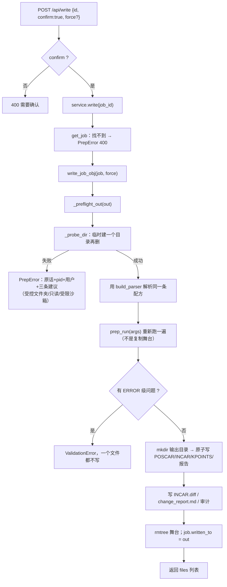

"重跑而不是复制舞台"是故意的：保证**你看到 diff 的那份配方 = 落盘的那份**，
并且写盘前再校验一次。输出目录已存在且非空时默认拒绝，只有 `force=true` 才覆盖。

判重与命名（同一段代码）：

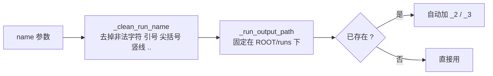

---

## 6. `prep.run` 内部（真正的"执行器"）

`prep.py:156`。它同时服务三条路：网页预览、网页写入、命令行 / 批量。

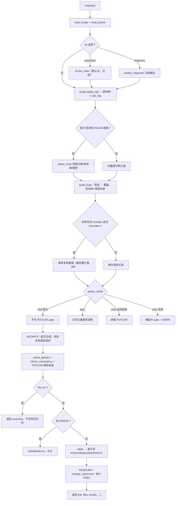

"原子写"= `_atomic_write`（先写临时文件再替换），避免中途崩溃留下半个 INCAR。

---

## 7. 结构操作怎么分发（`apply_ops`）

`recipe.py:268`。**每一步都是纯函数**：返回新 `Structure`，不改入参，
所以第 3 步报错时前两步的结果还在，不会"改了一半"。

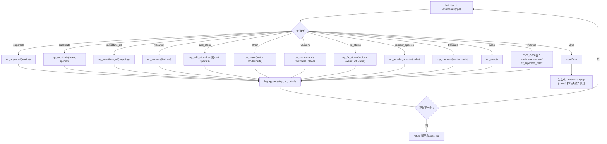

高阶 op 走 `EXT_OPS` 字典（`ops_ext.py`），新增一种只需登记一处，不用改 `apply_ops` 的分支。

---

## 8. INCAR 是怎么拼出来的

`incar.py:346`。三句话：**底稿优先、预设第二、用户覆盖最后**，每一步都过白名单。

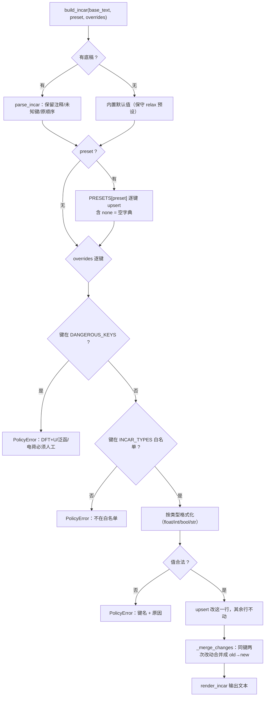

`preset="none"` 是特例：一个键都不加，用于"只改结构、别动 INCAR"。
配合第 6 节的"无 changes 就原样复制底稿"，网页上不会出现一整片无意义的 diff。

---

## 9. 批量：N 个材料 × M 个参数

`batch.py`。核心设计：**需求只理解一次**，得到模板配方；每个 (材料, 参数) 是模板的深拷贝 + 两处改动（`base_dir` 指到该材料、`incar.overrides` 加参数）。

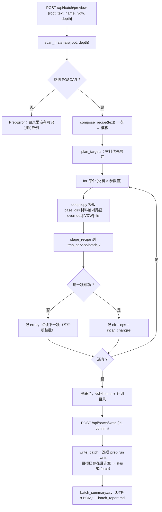

扫描规则：`scan_materials` 只看"含 POSCAR 的子目录"；`depth=0` 只看一层，`1` 往下一层。
上限来自 `[batch] max_materials=200 / max_dirs=500`，超了直接报错，不会跑一半。

---

## 10. 数据库：检索 → 下载 → 导入

`db.py`。三种来源三种走法，最后都落到 `materials\<provider>_<id>\`。

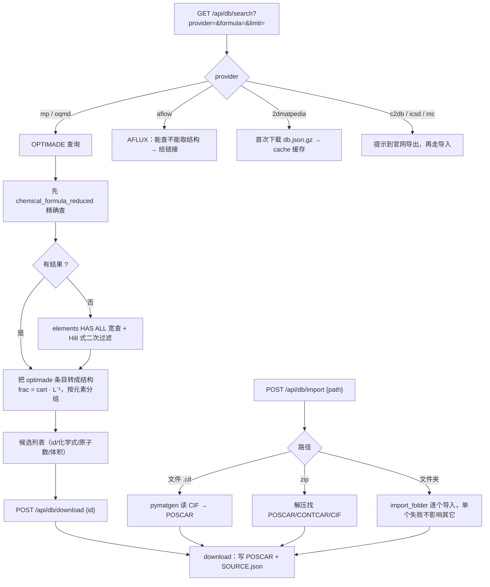

注意：`materials` 默认就是批量页的"根目录"，所以下载完可以直接去批量页扫。

---

## 11. 出错与降级：每一层怎么退

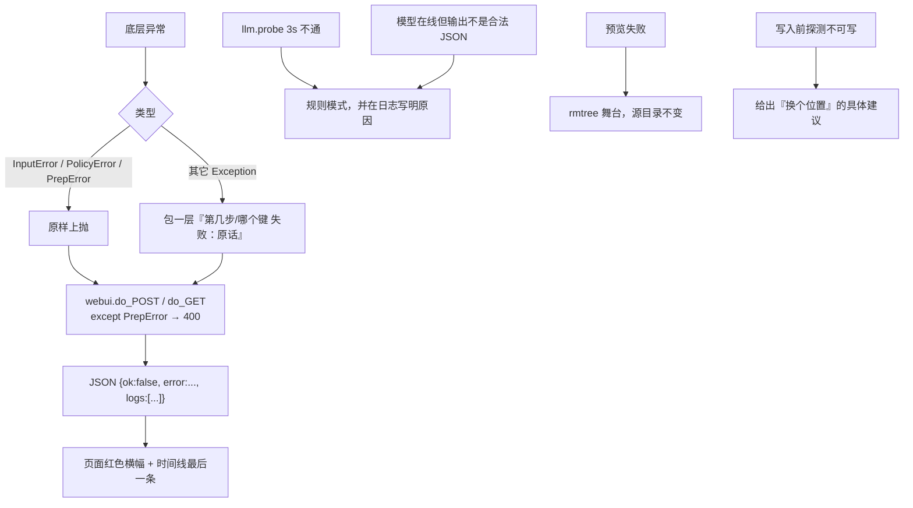

| 层 | 抛什么 | 谁接 | 用户看到 |
|---|---|---|---|
| `poscar/incar/kpoints` | `InputError` / `PolicyError` | 调用方 | 具体哪个键/第几步 |
| `prep.run` | `ValidationError` | webui/service | 一条条 `[ERROR] code: 说明` |
| `service` | `PrepError` | webui `do_POST` | HTTP 400 + 原话 + 建议 |
| `llm` | `LlmError` | `understand` | 不报错，退回规则并提示 |
| `browse` | `BrowserUnavailable` | webui | "弹不出来，手动粘贴路径" |

---

## 12. 一个 Job 的生命周期（磁盘上发生了什么）

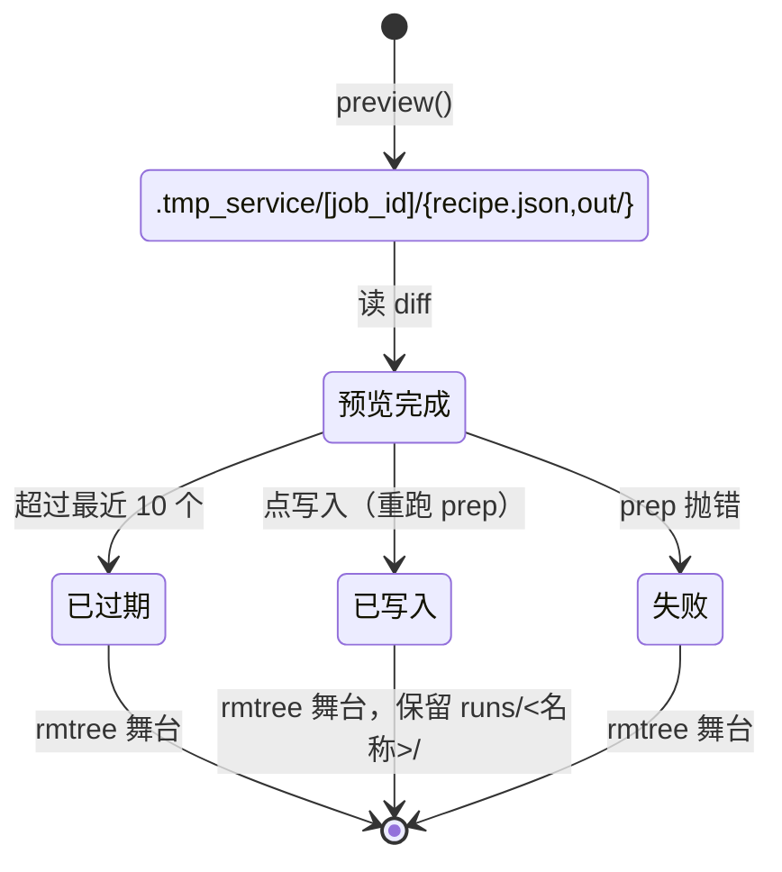

对应关系：

| 阶段 | 位置 | 会不会动源目录 |
|---|---|---|
| 预览 | `<repo>/.tmp_service/<job_id>/` | 不会（只读源目录） |
| 写入 | `<repo>/runs/<名称>/` 或你指定的目录 | 不会 |
| 批量 | `<repo>/batches/<批次>/<材料>/ivdw_<值>/` | 不会 |
| 下载 | `<repo>/materials/<provider>_<id>/` | 不适用 |
| 缓存 | `<repo>/cache/` | 不适用 |

---

## 13. 函数索引（按调用顺序）

| 文件:行 | 函数 | 职责 |
|---|---|---|
| `webui.py:438` | `main` | 起服务、开浏览器、退出清理 |
| `webui.py:241/350` | `do_GET` / `do_POST` | 路由、JSON、错误码 |
| `service.py:96` | `summarize_source` | 读源目录摘要（不含坐标） |
| `service.py:160` | `understand` | 探活 → 模型或规则 |
| `service.py:308` | `compose_recipe` | 理解 + 补全 + calc/IVDW 策略 |
| `service.py:341` | `stage_recipe` | 写 recipe.json → 调 prep → diff |
| `service.py:383` | `preview` | 舞台预览，返回 Job |
| `service.py:502` | `write_job_obj` | 预检 → 重跑 prep → 落盘 |
| `prep.py:156` | `run` | 读结构 → 执行 op → INCAR/KPOINTS → 校验 → 写盘 |
| `recipe.py:181` | `load_recipe` | 读 JSON → Recipe → 严格校验 |
| `recipe.py:268` | `apply_ops` | 逐 op 分发，纯函数，带步号报错 |
| `poscar.py:249` | `read_poscar_text` | 解析 POSCAR（含 Selective/速度/重复元素归一） |
| `poscar.py:446` | `write_poscar_text` | 输出 POSCAR（速度块、约束、尾部） |
| `incar.py:152` | `parse_incar` | 保注释/顺序的行模型 |
| `incar.py:346` | `build_incar` | 底稿 + 预设 + 覆盖（白名单/类型） |
| `incar.py:442` | `check_consistency` | 跨键校验（ENCUT/KPAR/ISMEAR…） |
| `kpoints.py:54` | `from_recipe` | 配方 → Kpoints 对象 |
| `kpoints.py:128` | `render_kpoints` | Kpoints → 文本 |
| `batch.py:89` | `scan_materials` | 找算例目录并读摘要 |
| `batch.py:227` | `preview_batch` | 一次理解 + N×M 舞台预览 |
| `batch.py:353` | `write_batch` | 逐项落盘 + CSV/Markdown 汇总 |
| `db.py:317` | `search` | 按 provider 分流检索 |
| `db.py:336` | `download` | 候选 → POSCAR + SOURCE.json |
| `db.py:403/450` | `import_file` / `import_folder` | 本地 CIF/POSCAR/zip 导入 |

---

## 14. 想看"某条具体命令会走哪条路"

| 你做的事 | 走的主链 |
|---|---|
| 双击 bat → 网页预览 | `webui.do_POST` → `service.preview` → `stage_recipe` → `prep.run`（dry 写舞台） |
| 网页点写入 | `service.write` → `write_job_obj` → `prep.run --write` |
| 终端 `chat` | `chat.main` → 同一套 `service.preview/write` |
| `python -m vasp_core.prep r.json --write` | 直接 `prep.run`，不经模型 |
| 批量预览/写入 | `batch.preview_batch` / `write_batch` → 每项 `service.stage_recipe` / `prep.run` |
| 数据库检索/下载 | `db.search` / `db.download`，不碰 `service` |
| 测试 | `tests/test_*.py` 直接调核心层，少数起临时 HTTP 服务 |

---

## 15. 维护这份图的方式

改代码时如果动了以下任一位置，请顺手更新对应小节：

- 新增一种结构操作 → 第 7 节 + `ops_ext.EXT_OPS`；
- 新增一个 HTTP 接口 → 第 4/5 节 + `webui.do_GET/do_POST`；
- 改了"预览/写入"的先后顺序 → 第 4、5 节；
- 新增数据库来源 → 第 10 节。

图里的行号会随提交漂移，函数名是稳定锚点；对不上时以函数名为准。
