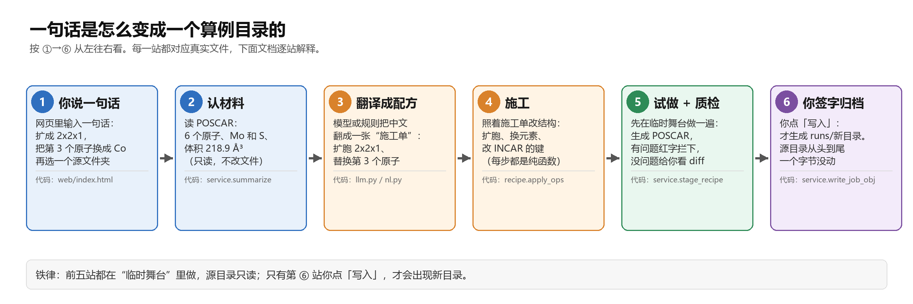
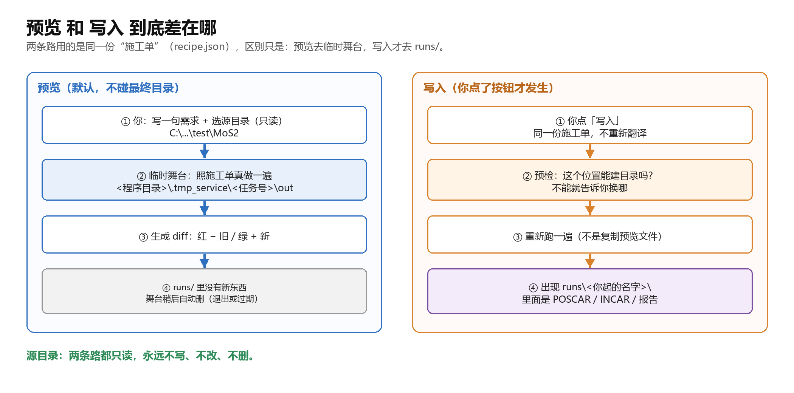

# 小白也能看懂：这个程序到底在干什么

> 这一份不出现"调用链""纯函数""diff"这种词，先用比喻和图片把流程讲清楚。
> 等你觉得"哦原来是这么回事"，再去看 [代码流程图.md](代码流程图.md) 的精确定义。
> 全程只有一句话需要记住：**源目录只读，它只往新文件夹里写东西。**

---

## 30 秒版（先读这四句）

1. 你在网页里写一句人话，比如"扩成 2x2x1，第 3 个原子换成 Co"。
2. 程序把它翻译成一张**施工单**（一份 JSON 表），再照着单子把结构改出来。
3. 它先在**临时工位**上试做一遍，把"原来长什么样 / 现在长什么样"摆给你看（diff）。
4. 你觉得没问题，点「写入」，它才在 `runs\` 下新建一个文件夹，把 POSCAR/INCAR 放进去。

你的源文件夹从头到尾**只被读、没被写**。

---

## 一、整条流水线长这样



从左往右六站，每一站都有明确分工：

| 站 | 谁在干活 | 用大白话说 | 对应代码（想核对时看） |
|---|---|---|---|
| ① | 你 | 写一句需求、选一个**含 POSCAR 的文件夹** | 网页 `web/index.html` |
| ② | 前台接待 | 只**看**材料：几个原子、什么元素、晶胞多大；看完就退下，不搬东西 | `service.summarize_source` |
| ③ | 翻译 | 把中文翻成施工单；模型不在线就用"常用说法手册"顶班 | `llm.py` / `nl.py` |
| ④ | 工头 | 照施工单拆工序：先扩胞、再换原子……每道工序都检查工具对不对 | `recipe.apply_ops` |
| ⑤ | 工人 + 质检 | 真改结构；改完检查有没有明显错误；在一个**临时工位**里做 | `poscar.py`、`incar.py`、`kpoints.py` |
| ⑥ | 档案员 | 你点「写入」后，才把成品放进 `runs\新文件夹\`，并写一份变更报告 | `service.write_job_obj`、`report.py` |

> 记住"临时工位"这个词：第 ⑤ 站所有产物都在 `.tmp_service\` 里，不在你的文件夹，也不在 `runs\`。

---

## 二、为什么要点两次（预览 / 写入）



- **预览**：在临时工位试做，给你看 diff；`runs\` 里什么都不会多出来。
- **写入**：你点头之后，它拿**同一份施工单**重新做一遍，这次直接放进 `runs\`。

为什么写入要"重新做一遍"而不是把预览文件复制过去？
因为复制会跳过检查；重做能保证"你看到的 diff"和"真正落盘的文件"是同一份施工单算出来的。

---

## 三、跟着一个真实例子走一遍

假设源文件夹是 `C:\Users\28476\Desktop\test\MoS2`（6 个原子），你说：**"扩成 2x2x1"**。

### 第 1 步：前台看到的（只读）

```
POSCAR：Mo S，6 个原子
a/b/c = 3.191 / 3.191 / 24.837 Å
体积 218.9578 ų
INCAR：有   KPOINTS：有
```

注意：它**没有**把坐标发给模型，只发了"几原子、什么元素、多大"这种摘要。

### 第 2 步：翻译出来的施工单（简化）

```json
{
  "version": 2,
  "name": "MoS2_2x2x1",
  "calc": "none",
  "base_dir": "C:\\Users\\28476\\Desktop\\test\\MoS2",
  "structure": {
    "file": "POSCAR",
    "ops": [{"op": "supercell", "scaling": [2, 2, 1]}]
  },
  "incar": {"preset": null, "overrides": {}},
  "kpoints": null
}
```

几个关键点，用大白话解释：

- `ops` 是"工序清单"，这里只有一条：扩胞 2×2×1。
- `calc: "none"` 表示"你没提弛豫/静态/能带，所以**不要**顺手改 INCAR"。
- `incar.overrides: {}` 是空的，表示"一个 INCAR 键都不改"。
- `kpoints: null` 表示"不生成新的 KPOINTS，源目录里有就原样复制"。

### 第 3 步：工头施工

结构从 6 个原子变成 24 个原子（2×2×1 就是把原来的格子复制 4 份）：

```
原子数：6 → 24
体积：218.9578 → 875.8312 ų
元素：Mo、S
```

### 第 4 步：质检 + 给你看小样

网页上出现 diff（红 − 旧，绿 + 新），大概像这样：

```
--- POSCAR（源）
+++ POSCAR（新）
-  3.180130000000
+  6.360260000000
...
原子数 6 → 24
```

同时列出一句"待生成文件"：`POSCAR、INCAR、KPOINTS、change_report.md`。

### 第 5 步：你点「写入」

真正落盘：

```
runs\MoS2_2x2x1\
├── POSCAR              ← 24 个原子
├── INCAR               ← 从源目录原样复制（因为没改参数）
├── KPOINTS             ← 从源目录原样复制
└── change_report.md    ← 这次改了什么、为什么
```

源目录 `C:\...\test\MoS2` 里的文件，一个字节都没变。

---

## 四、网页上的每个按钮，背后是谁

| 你点的东西 | 程序里发生什么 | 会写文件吗 |
|---|---|---|
| 「选择…」源目录 | 弹系统文件夹选择框 | 不写 |
| 「预览」 | 读源目录 → 翻译 → 临时工位试做 → 算 diff | 只写 `.tmp_service\`（临时） |
| 「写入」 | 预检能不能写 → 重新做一遍 → 放进 `runs\` | 写 `runs\新文件夹\` |
| 「查看 runs」 | 打开资源管理器；打不开就在网页里列目录 | 不写 |
| 批量「扫描」 | 找哪些子文件夹里有 POSCAR | 不写 |
| 批量「预览」 | 只翻译一次，然后 N 个材料 × M 个参数各试做一遍 | 只写临时目录 |
| 批量「全部写入」 | 逐项落盘，附一份 CSV 汇总 | 写 `batches\` |
| 数据库「检索」 | 联网查 Materials Project 等 | 不写 |
| 数据库「下载」 | 把候选结构存成 POSCAR | 写 `materials\` |

---

## 五、几个名词，用生活里的东西解释

| 词 | 你可以理解成 |
|---|---|
| **模块**（`poscar.py` 这种） | 一个抽屉，里面放一类工具。`import` 就是"打开抽屉拿工具" |
| **函数** | 一张菜谱卡片：给它原料（参数），它按步骤做，最后交回成品（返回值） |
| **纯函数** | 不弄脏厨房的菜谱：只拿你的原料做新菜，**不改你原来那盘**。本程序改结构全是这种 |
| **JSON / 配方** | 一张填好的表格，电脑和你都能读。上面第 3 步那张就是 |
| **dict（字典）** | 查字典：给一个"键"，拿到对应的"值"，比如 `{"op": "supercell"}` |
| **diff** | 两张纸叠在一起对着灯看，只标出不一样的地方：红的是旧，绿的是新 |
| **临时工位 / 舞台** | `.tmp_service\` 下的临时文件夹，试做用，最后会删 |
| **POSCAR / INCAR / KPOINTS** | VASP 的三样输入：结构、参数、K 点 |
| **原子 / 晶胞 / 超胞** | 原子是积木；晶胞是一个"重复单元"；超胞是把单元复制几份拼大 |

---

## 六、新手最常问的 8 个问题

**1. 没开 Ollama / 模型没装，还能用吗？**
能。程序先花 3 秒探一下模型，不在线就自动用"规则模式"（认得"扩成 2x2x1""换成 Co""加 15 埃真空"这类常见说法），并在日志里写明"模型不可用，改用规则"。

**2. 为什么预览之后 `runs\` 里没有东西？**
预览故意不写最终目录，只在临时工位做。要留下成品必须点「写入」。

**3. 为什么写入要重跑一遍，不直接复制？**
复制会跳过校验。重跑能保证"你看到的 diff"和"真正写出的文件"来自同一份施工单。

**4. 我的源文件夹会被改吗？**
不会。全程只读；输出永远写到新目录。测试里专门有一条检查"源目录 mtime 不变"。

**5. `.tmp_service` 是什么？能删吗？**
是临时工位。程序正常退出会清掉；预览任务超过 10 个也会自动清旧的。你手动删也没关系（别在预览进行中删）。

**6. 报错红字看不懂怎么办？**
看红框里最后一行，通常写着"哪一步 + 原话"，例如 `structure.ops[1](supercell) 执行失败：坐标数量…`。这句话就是拿去搜索的关键词。

**7. 它会不会偷偷帮我加 INCAR 参数？**
不会。只有你明确说"弛豫/优化/静态/能带"才套预设；只改结构时 INCAR 原样复制。色散（IVDW）也必须你点名，模型擅自加的会被删掉并提示。

**8. 我能不能只用命令行，不开网页？**
能：`python -m vasp_core prep 配方.json --write`，或者 `python -m vasp_core chat` 走终端问答。

---

## 七、想自己读代码，按这个顺序（每步 5–10 分钟）

1. `vasp_core/__main__.py` —— 只有几十行，看"五个命令怎么转发"。
2. `vasp_core/service.py` 的 `preview()`（约 383 行）—— 主线：读 → 翻译 → 试做 → diff。
3. `vasp_core/recipe.py` 的 `apply_ops()`（约 268 行）—— 施工单怎么变成一道道工序。
4. `vasp_core/poscar.py` 的 `op_supercell()` —— 挑一个最简单的工序看它怎么改坐标。
5. `vasp_core/prep.py` 的 `run()`（约 156 行）—— 最后怎么校验、怎么落盘。

读的时候记住三件事，就不会迷路：

- 函数名基本是"动词 + 名词"（`read_poscar`、`build_incar`、`write_batch`）；
- 每个 `if` 大多在回答"用户到底要不要这个"；
- 看到 `raise` 就是"这里会拦下并报错"，报错文字是写给你看的，不是给机器看的。

---

## 八、下一步看哪份

| 你现在想要 | 去看 |
|---|---|
| 更精确的调用链、时序图 | [代码流程图.md](代码流程图.md) |
| 每一层负责什么、出错先看哪层 | [架构与流程.md](架构与流程.md) |
| 网页每个控件的用法 | [网页使用.md](网页使用.md) |
| 批量怎么用 | [批量处理.md](批量处理.md) |
| 数据库怎么检索/下载/导入 | [数据库下载.md](数据库下载.md) |
